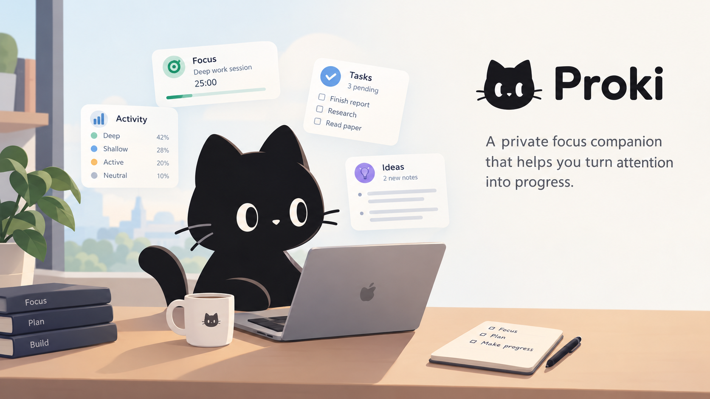

<p align="center">
  
</p>

<h1 align="center">✨ Make room for the work that matters.</h1>

<p align="center">
  Proki helps you see where your time goes, decide what to do next, and return to the work when your attention wanders.
</p>

<p align="center">
  <a href="https://img.shields.io/github/downloads/Combi2k2/proki/total"></a>
  <a href="https://github.com/Combi2k2/proki/stargazers"></a>
  <a href="https://github.com/Combi2k2/proki/actions/workflows/release.yml"></a>
  <a href="LICENSE"></a>
  
  <a href="https://buymeacoffee.com/combi2k2"></a>
</p>

<a id="download"></a>
<p align="center">
  <a href="https://github.com/Combi2k2/proki/releases/download/v0.1.4/Proki_0.1.4_aarch64.dmg">
    
  </a>
  &nbsp;
  <a href="https://github.com/Combi2k2/proki/releases/download/v0.1.4/Proki_0.1.4_x64-setup.exe">
    
  </a>
</p>

## 📑 Table of contents

- [Why Proki](#why-proki)
- [Features](#features)
- [Planned and exploring](#planned)
- [Privacy](#privacy)
- [Try Proki](#try-proki)
- [Docs](#docs)
- [Support](#support)
- [License](#license)

---

<a id="why-proki"></a>
## ✨ Why Proki

Books like *Deep Work* and *Atomic Habits* offer useful ideas for changing how we work. Proki starts with a question: what would it take to put your own idea into practice, day after day?

Choose a principle that matters to you, then express it through signals and a formula: a measurable proxy for things like focus or progress. The measure is not the philosophy itself; it is a way to notice when the idea is showing up in your day. Turn that measure into a routine, and Proki can respond when the moment calls for it. Refine the formula and routine as you learn what works for you.

With MCP, a connected AI assistant can help you design, explain, or revise those formulas and routines whenever your approach changes. Your philosophy stays yours; Proki helps you make it actionable.

<a id="features"></a>
## 🧭 Features

### 🚀 Getting started

| What you need | How Proki helps | Status |
| --- | --- | --- |
| Install it | Installers for macOS and Windows; ActivityWatch setup included. | 🟡 |
| Start well | First-run welcome, ActivityWatch check, and a link to your browser extension. | 🟡 |
| Always at hand | Proki lives in your menu bar or system tray: the focus of the last minutes, a session's time, New note, quit. | ✅ |

### ⏱️ Your day

| What you need | How Proki helps | Status |
| --- | --- | --- |
| See today at a glance | Focus, daily goal, streak, next task, and your notes for the day. | ✅ |
| Stay with a task | Start a task-linked focus session and get gentle prompts when useful. | ✅ |
| Popups that answer back | Respond to short prompts about focus, apps, or where a note belongs. | 🟡 |

### 📝 Your work

| What you need | How Proki helps | Status |
| --- | --- | --- |
| Make a plan | Group tasks under goals, choose what’s next, and break down a todo with AI. | ✅ |
| Keep the thought | Capture notes; Proki sorts them into todos, ideas, or thoughts and checks when unsure. | ✅ |
| Follow a note to its task | Turn a todo note into a task with a link back to it. | ✅ |
| Add a little fun | Personalize popup stickers and pictures. | ✅ |

### 📈 Insight

| What you need | How Proki helps | Status |
| --- | --- | --- |
| Know where time goes | Choose how each app or website counts toward focus, breaks, or distractions. | ⚪ |
| Watch the trend | Explore focus and activity patterns across days and weeks. | 🟡 |

### 🌱 Routines that come with it

Proki ships with a set of routines built on ideas from *Deep Work* and *Atomic Habits*. Each one is yours to switch off or change.

| Routine | When it speaks up | The idea behind it |
| --- | --- | --- |
| Morning start | When your day starts: a hello for the time of day, today's first task, and time to settle in if you want it. | A start ritual; make the next step obvious |
| Focus sessions | During a session: a word when you drift, a break after 50 minutes, a "nice one" when you stop. | Deep work in blocks; make it satisfying |
| Session suggestions | When you're already deep in work: offers a session, at most every 2 hours. | Protect the flow you're in |
| Task picker | At a session's start: what it's for. | Say what you'll do and when |
| Time on tasks | Counts a task's time; checks in after a break, or when it runs past its estimate. | Know what work really costs |
| Task reminders | A task due soon or put off again and again: start it, or say what's in the way. | Make it easy: split what's too big |
| Planner | Talks a todo through and turns it into tasks. | Plan the work, then work the plan |
| Inbox guard | Email or chat during a session, once a session: it can wait. | Hub and spoke |
| Busywork check | Once a day, if small tasks take over 30% of your time. | A budget for shallow work |
| Thought catcher | After 5 minutes of distraction: anything on your mind? | Write it down to let it go |
| Note sorter | Sorts your notes quietly; asks only when one sounds urgent, or when it isn't sure. | Keep the thought, lose the clutter |
| App labels | A new app or website: does it count, and what kind is it? | Know where time goes |
| End of workday | As the workday winds down: what's still open, on Fridays the week, then you're free. | Shutdown complete |
| Bedtime | From 22:00: time to wind down; past midnight, offers to lock the screen. | Rest is part of the work |
| Day clock | Never: it counts your focused minutes and your streak. | Keep score of the lead measure |

Proki keeps quiet between the questions it asks on its own, 30 minutes by default. A question you leave unanswered makes the next wait twice as long.

### 🎛️ Make it yours

| What you need | How Proki helps | Status |
| --- | --- | --- |
| Personalize routines | Read, switch off, and adjust the prompts that guide your day. | ✅ |
| See routines in action | Follow a routine’s steps and see what it will do next. | ✅ |
| Organize your information | Create tables for tasks, notes, and other records. | ✅ |
| Learn as you go | Try expressions and actions on sample data in the built-in Help area. | ✅ |

### 💬 Support

| What you need | How Proki helps | Status |
| --- | --- | --- |
| Get started | Three first steps in Help, each with the button that takes it, and answers to common questions. | ✅ |
| Share feedback | Send a suggestion with up to three screenshots, even offline; Proki sends it once you're back online. | 🟡 |
| Back the project | The Support page links Proki's code on GitHub and its Buy me a coffee page. | ✅ |

<a id="ai-agent"></a>
### 🤖 AI Agent

Let Claude Code, Codex, OpenClaw, or any MCP-compatible agent read and modify your tasks,
notes, routines, media and settings, over a local, token-protected connection. With the
**proki-automation** skill, it turns plain requests like *"remind me to stretch every hour,
but not in calls"* into a routine, edits one, or explains why one did or didn't fire.

1. Connect your agent to Proki's MCP server (commands for each agent below).
2. Add the skill:

   ```bash
   npx skills add Combi2k2/proki --skill proki-automation
   ```

   This works for any agent the [skills CLI](https://github.com/vercel-labs/skills) supports.
   Otherwise, copy [`skills/proki-automation/`](skills/proki-automation) into your agent's
   skills folder.

<details>
<summary><b>Claude Code</b></summary>

```bash
claude mcp add proki -- proki mcp
```

</details>

<details>
<summary><b>Codex</b></summary>

```bash
codex mcp add proki -- proki mcp
```

</details>

<details>
<summary><b>OpenClaw</b></summary>

```bash
openclaw mcp set proki '{"command":"proki","args":["mcp"]}'
```

</details>

*Status: ✅ ready · 🟡 needs polish · ⚪ not reviewed.*

<a id="planned"></a>
### 📋 Planned and exploring

These ideas are not available yet. The planned items are the next product foundations; the rest need more thought before they become commitments.

| Idea | How it could work | Status |
| --- | --- | --- |
| Bring automations with you | Import and export automation formulas so you can back them up or share them. | 📌 Planned |
| Keep media in sets | Group stickers and other media into smaller packs you can organize and switch between. | 📌 Planned |
| Share community-made patches | Explore a catalog for automation and media packs after import/export and safe review are in place. | 🔍 Exploring |
| Choose how AI is paid for | Keep bring-your-own-key as an option; explore an account plan for using Proki-hosted LLM and Jev services. An account would keep only basic details, never your data. | 🔍 Exploring |
| Move your data between devices | Start with a portable local backup and restore. Decide whether any later sync should use a file, nearby transfer, or a server. | 🔍 Exploring |

*📌 Planned means intended, not released. 🔍 Exploring means the approach is still open.*

<a id="privacy"></a>
## 🔒 Privacy

ActivityWatch keeps your activity history on your computer: app names, window titles, and
browser pages. Its optional input watcher counts keys and clicks; it never records which keys
you press.

Proki's own parts talk to each other only inside your computer. If you connect an AI service,
Proki sends it just the context each request needs. You choose the provider, and its key stays
on your computer.

<a id="try-proki"></a>
## 🚀 Try Proki

Proki is an early build for macOS (Apple silicon) and Windows. There's no Linux version yet.

### 📦 From [installer](#download)

Every release is on the [Releases page](https://github.com/Combi2k2/proki/releases).
Setup includes ActivityWatch; Proki offers its browser extension on first launch.

**macOS**

1. Open the `.dmg` and drag **Proki** into **Applications**.
2. Before opening it, run these two commands in Terminal. The first lets macOS open an app
   that isn't notarized by Apple yet; the second clears permissions left by an older version.

   ```bash
   xattr -cr /Applications/Proki.app
   tccutil reset All app.proki.ui
   ```

3. Open Proki. In **System Settings › Privacy & Security**, turn Proki on under
   **Accessibility** and **Input Monitoring**, so it can see which app you're in and whether
   you're active.

Run the same two commands after each update.

**Windows**

Run the installer. If SmartScreen appears, choose **More info › Run anyway**.

### 🧑‍💻 From source

Install [ActivityWatch](https://activitywatch.net), [uv](https://docs.astral.sh/uv/),
[Node.js](https://nodejs.org/) and NATS. On macOS:

```bash
brew install nats-server
```

Then, from the repository folder, build the app and start Proki:

```bash
uv sync
cd ui && npm install && npm run app && cd ..
uv run launch.py
```

<a id="docs"></a>
## 📚 Docs

Each feature has a one-minute page in [docs](docs/README.md), starting with the [architecture](docs/NF-001-architecture.md).

<a id="support"></a>
## ☕ Support

Proki is free, open source, and made by one person. If it makes your days easier, you can
[buy me a coffee](https://buymeacoffee.com/combi2k2). A star, a bug report, or a suggestion from the app's
Support page helps just as much.

<p>
  <a href="https://buymeacoffee.com/combi2k2"></a>
</p>

<a id="license"></a>
## 📄 License

[MIT](LICENSE)
