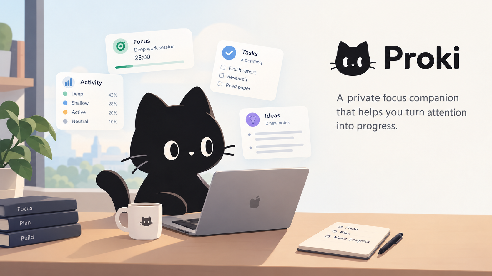

<p align="center">
  
</p>

<h1 align="center">✨ Make room for the work that matters.</h1>

<p align="center">
  Proki helps you see where your time goes, decide what to do next, and return to the work when your attention wanders.
</p>

<p align="center">
  <a href="https://github.com/Combi2k2/proki/stargazers"></a>
  <a href="https://github.com/Combi2k2/proki/actions/workflows/release.yml"></a>
  <a href="LICENSE"></a>
  
</p>

<a id="download"></a>
<p align="center">
  <a href="https://github.com/Combi2k2/proki/releases/download/v0.1.0/proki_0.1.0_aarch64.dmg"></a>
  <a href="https://github.com/Combi2k2/proki/releases/download/v0.1.0/proki_0.1.0_x64-setup.exe"></a>
</p>

<p align="center">
  <a href="#why-proki">Why Proki</a> ·
  <a href="#what-you-can-do">Features</a> ·
  <a href="#your-day-stays-yours">Privacy</a> ·
  <a href="#try-proki">Try it</a> ·
  <a href="#for-builders">Builders</a>
</p>

---

<a id="why-proki"></a>
## ✨ Why Proki

Books like *Deep Work* and *Atomic Habits* offer useful ideas for changing how we work. Proki starts with a question: what would it take to put your own idea into practice, day after day?

Choose a principle that matters to you, then express it through signals and a formula: a measurable proxy for things like focus or progress. The measure is not the philosophy itself; it is a way to notice when the idea is showing up in your day. Turn that measure into a routine, and Proki can respond when the moment calls for it. Refine the formula and routine as you learn what works for you.

With MCP, a connected AI assistant can help you design, explain, or revise those formulas and routines whenever your approach changes. Your philosophy stays yours; Proki helps you make it actionable.

<a id="what-you-can-do"></a>
## 🧭 What you can do

### 🚀 Getting started

| What you need | How Proki helps | Status |
| --- | --- | --- |
| Install it | Installers for macOS and Windows; ActivityWatch setup included. | 🟡 |
| Start well | First-run welcome, ActivityWatch check, and a link to your browser extension. | 🟡 |
| Always at hand | Proki lives in your menu bar or system tray: the focus of the last minutes, a session's time, New note, quit. | ✅ |

### ⏱️ Your day

| What you need | How Proki helps | Status |
| --- | --- | --- |
| See today at a glance | Focus, daily goal, streak, next task, and your notes for the day. | ✅ |
| Stay with a task | Start a task-linked focus session and get gentle prompts when useful. | ✅ |
| Popups that answer back | Respond to short prompts about focus, apps, or where a note belongs. | 🟡 |

### 📝 Your work

| What you need | How Proki helps | Status |
| --- | --- | --- |
| Make a plan | Group tasks under goals, choose what’s next, and break down a todo with AI. | ✅ |
| Keep the thought | Capture notes; Proki sorts them into todos, ideas, or thoughts and checks when unsure. | ✅ |
| Follow a note to its task | Turn a todo note into a task with a link back to it. | ✅ |
| Add a little fun | Personalize popup stickers and pictures. | ✅ |

### 📈 Insight

| What you need | How Proki helps | Status |
| --- | --- | --- |
| Know where time goes | Choose how each app or website counts toward focus, breaks, or distractions. | ⚪ |
| Watch the trend | Explore focus and activity patterns across days and weeks. | 🟡 |

### 🎛️ Make it yours

| What you need | How Proki helps | Status |
| --- | --- | --- |
| Personalize routines | Read, switch off, and adjust the prompts that guide your day. | ✅ |
| See routines in action | Follow a routine’s steps and see what it will do next. | ✅ |
| Organize your information | Create tables for tasks, notes, and other records. | ✅ |
| Learn as you go | Try expressions and actions on sample data in the built-in Help area. | ✅ |

### 🤝 AI and assistants

| What you need | How Proki helps | Status |
| --- | --- | --- |
| AI when you need it | Choose a provider for AI-assisted planning and prompts. | ✅ |
| Connect an assistant | Let Claude Code, Codex, OpenClaw, or another compatible assistant use your Proki tasks and routines. | ✅ |
| Share feedback | Send a suggestion, even when you’re offline; Proki queues it to send later. | 🟡 |

*Status: ✅ ready · 🟡 needs polish · ⚪ not reviewed.*

<a id="your-day-stays-yours"></a>
## 🔒 Your day stays yours

ActivityWatch keeps activity history on your computer, such as app names, window titles, and browser pages. Its optional input watcher records activity counts, not the keys you press.

If you connect an AI service, Proki sends it the context needed for each request. You choose the provider; its key stays on your computer.

<a id="try-proki"></a>
## 🚀 Try Proki

Proki is an early build. macOS (Apple silicon) is tested; Windows is not yet tested on a real machine, and Linux installers are not available.

### 📦 From installer

The current macOS and Windows preview installers are linked at the top of this README. They are temporary GitHub Actions artifacts, not a versioned release. ActivityWatch is included in setup and its browser extension is offered on first launch.

- **macOS:** Open the `.dmg` and drag Proki to Applications. If macOS blocks the unsigned app, run `xattr -cr /Applications/proki.app` once.
- **Windows:** Run the installer. If SmartScreen appears, choose **More info → Run anyway**.

### [⬆️ Back to installer downloads](#download)

### 🧑‍💻 From source

Install ActivityWatch, NATS, [uv](https://docs.astral.sh/uv/), and [Node.js](https://nodejs.org/). On macOS, install NATS with `brew install nats-server`, then from the repo folder:

```bash
uv sync
cd ui && npm install && npm run app
cd ..
uv run launch.py
```

For browser tracking, add ActivityWatch’s browser extension. Quit Proki or press `Ctrl-C` to stop it.

<a id="for-builders"></a>
## 🛠️ For builders

Compatible AI assistants can access Proki’s tasks, routines, media, and settings through its local, token-protected MCP connection.

Choose **Install command-line tool…** in the tray menu, then add `proki mcp` to your assistant:

```bash
claude mcp add proki -- proki mcp
codex mcp add proki -- proki mcp
openclaw mcp set proki '{"command":"proki","args":["mcp"]}'
```

See the [feature review](docs/F-002-feature-review.md), [architecture notes](docs/components.md), and [demo script](docs/personal-ai-hackathon-demo.md).

## 📄 License

[MIT](LICENSE)
